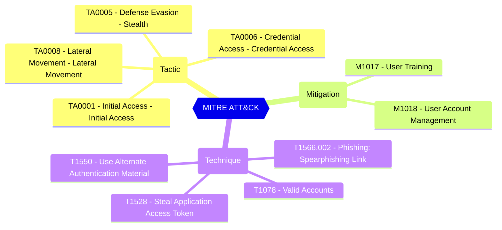

Counts user consent assignments outside microsoft-user-default-low and microsoft-user-default-recommended. Either accepted policy or both passes. An explicit empty assignment collection or only resource-specific consent assignments passes because no default ManagePermissionGrantsForSelf policy is assigned. Missing or null assignment data is skipped. The legacy unrestricted policy fails, including when mixed with other policies. Other user consent policies, including custom policies and mail-client exceptions, require manual review and are skipped unless the legacy policy is also assigned. A pass confirms assignment compliance only; this check does not evaluate policy conditions, other consent authorization mechanisms, or existing grants.

Disable user consent or assign only microsoft-user-default-low, microsoft-user-default-recommended, or both for default user self-consent. Accepting microsoft-user-default-recommended trusts Microsoft's evolving recommendations and does not verify a fixed set of permission restrictions. Review other user consent policies, including custom policies and microsoft-user-default-allow-consent-apps mail-client exceptions, by retrieving their includes and excludes from policies/permissionGrantPolicies. Any assigned policy can authorize consent independently; a restrictive policy does not override a permissive one. Remove the legacy unrestricted self-consent assignment. Preserve and assess ManagePermissionGrantsForOwnedResource assignments separately. See https://learn.microsoft.com/entra/identity/enterprise-apps/manage-app-consent-policies.

#### Test script
```
https://graph.microsoft.com/beta/policies/authorizationPolicy
.permissionGrantPolicyIdsAssignedToDefaultUserRole -eq '0'
```


#### Related links

- [Open in Graph Explorer](https://developer.microsoft.com/graph/graph-explorer?request=policies/authorizationPolicy&method=GET&version=beta&GraphUrl=https://graph.microsoft.com)
- [authorizationPolicy resource type - Microsoft Graph beta | Microsoft Learn](https://learn.microsoft.com/graph/api/resources/authorizationpolicy?view=graph-rest-beta)
- [View in Microsoft Entra admin center](https://entra.microsoft.com/#view/Microsoft_AAD_UsersAndTenants/UserManagementMenuBlade/~/UserSettings)

## MITRE ATT&CK


|Tactic|Technique|Mitigation|
|---|---|---|
|[TA0001 - Initial Access - Initial Access](https://attack.mitre.org/tactics/TA0001)<br/>[TA0005 - Defense Evasion - Stealth](https://attack.mitre.org/tactics/TA0005)<br/>[TA0006 - Credential Access - Credential Access](https://attack.mitre.org/tactics/TA0006)<br/>[TA0008 - Lateral Movement - Lateral Movement](https://attack.mitre.org/tactics/TA0008)|[T1566.002 - Phishing: Spearphishing Link](https://attack.mitre.org/techniques/T1566/002)<br/>[T1078 - Valid Accounts](https://attack.mitre.org/techniques/T1078)<br/>[T1550 - Use Alternate Authentication Material](https://attack.mitre.org/techniques/T1550)<br/>[T1528 - Steal Application Access Token](https://attack.mitre.org/techniques/T1528)|[M1017 - User Training](https://attack.mitre.org/mitigations/M1017)<br/>[M1018 - User Account Management](https://attack.mitre.org/mitigations/M1018)|


<!--- Results --->
%TestResult%
