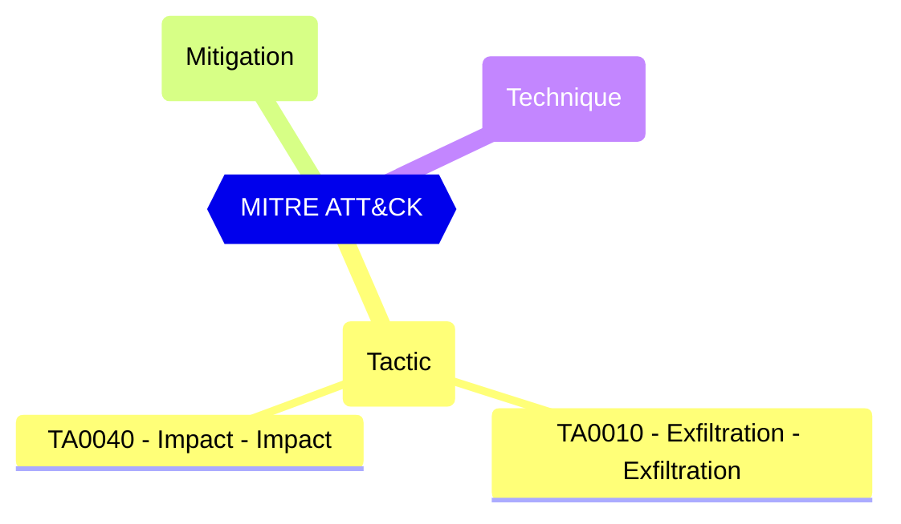

Restricts the creation of Entra ID (Azure AD) tenants to the global administrator or tenant creator roles. Anyone who creates a tenant will become the global administrator for that tenant.

Restrict tenant creation by non-admin users. Users assigned the Tenant Creator role can still create tenants when this setting is false.

#### Test script
```
https://graph.microsoft.com/beta/policies/authorizationPolicy
.defaultUserRolePermissions.allowedToCreateTenants -eq 'false'
```

#### Remediation action

Microsoft Graph PowerShell: ```Update-MgPolicyAuthorizationPolicy -BodyParameter @{DefaultUserRolePermissions = @{AllowedToCreateTenants = $false}}```

#### Related links

- [Open in Graph Explorer](https://developer.microsoft.com/graph/graph-explorer?request=policies/authorizationPolicy&method=GET&version=beta&GraphUrl=https://graph.microsoft.com)
- [authorizationPolicy resource type - Microsoft Graph beta | Microsoft Learn](https://learn.microsoft.com/graph/api/resources/authorizationpolicy?view=graph-rest-beta)
- [View in Microsoft Entra admin center](https://entra.microsoft.com/#view/Microsoft_AAD_UsersAndTenants/UserManagementMenuBlade/~/UserSettings)

## MITRE ATT&CK


|Tactic|Technique|Mitigation|
|---|---|---|
|[TA0010 - Exfiltration - Exfiltration](https://attack.mitre.org/tactics/TA0010)<br/>[TA0040 - Impact - Impact](https://attack.mitre.org/tactics/TA0040)|||


<!--- Results --->
%TestResult%
