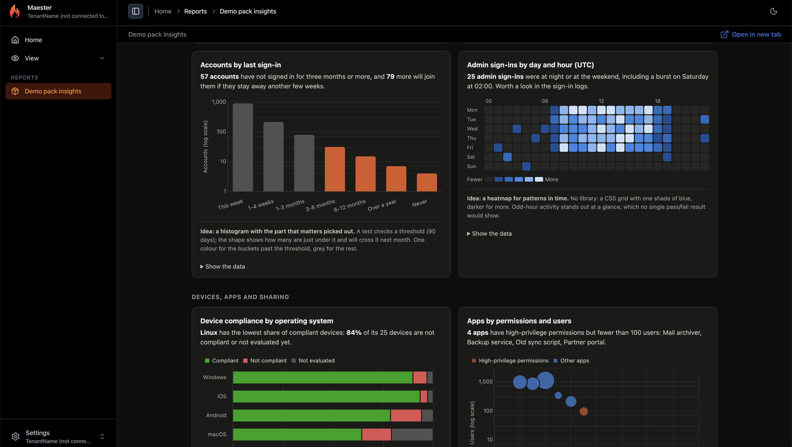
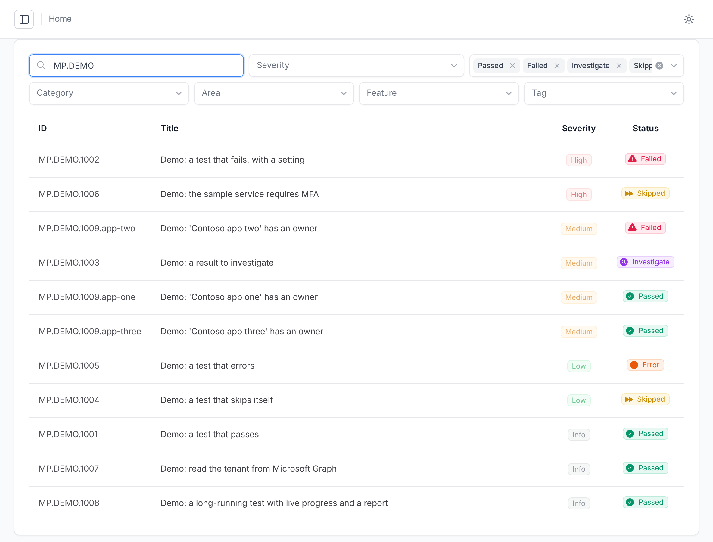
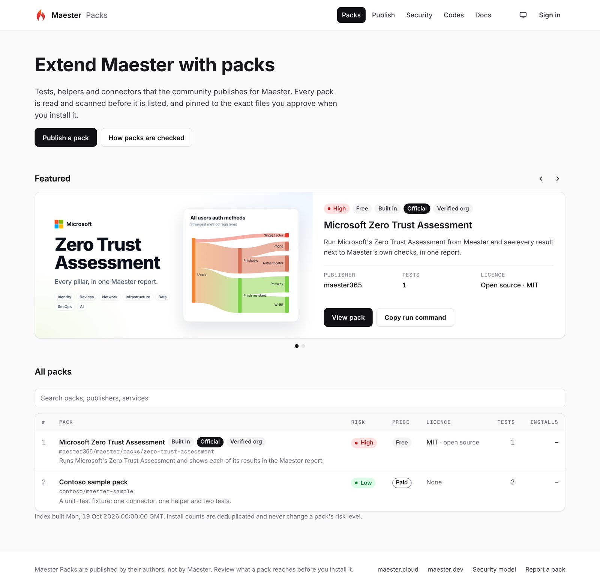
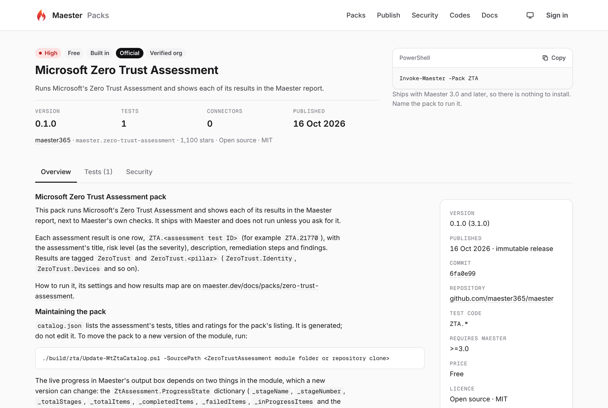
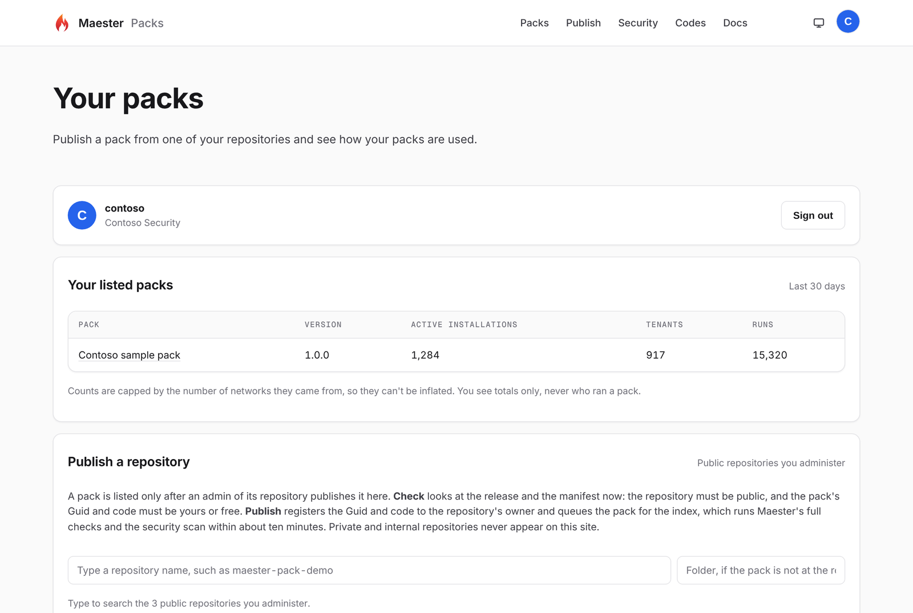
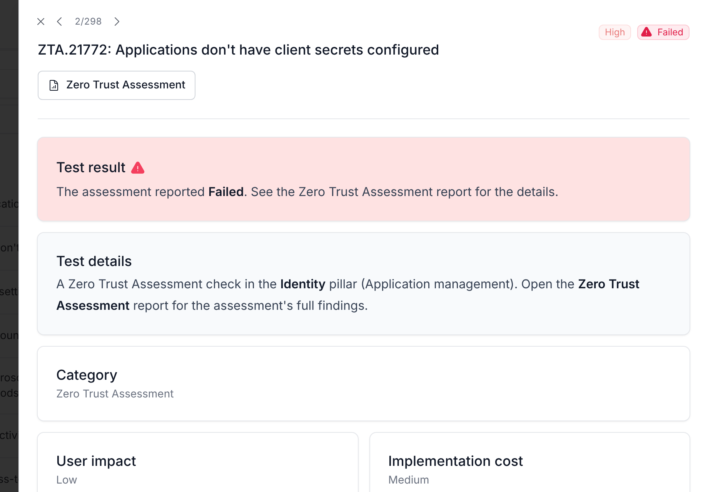
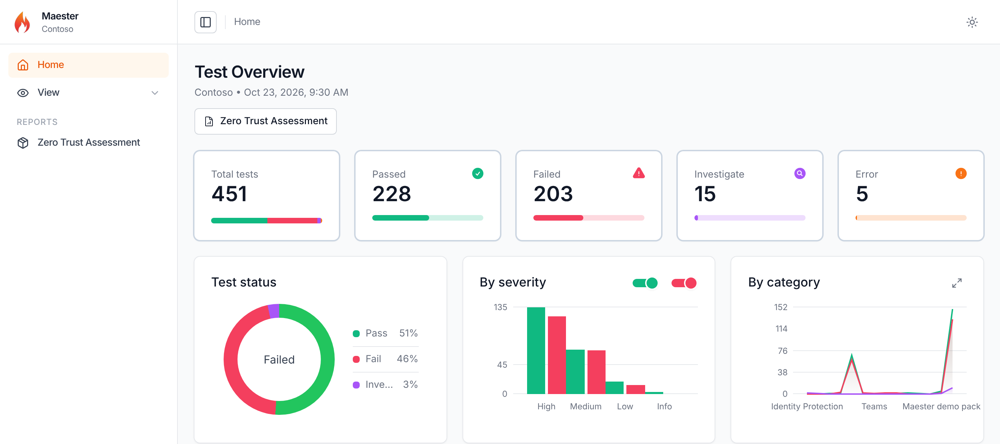
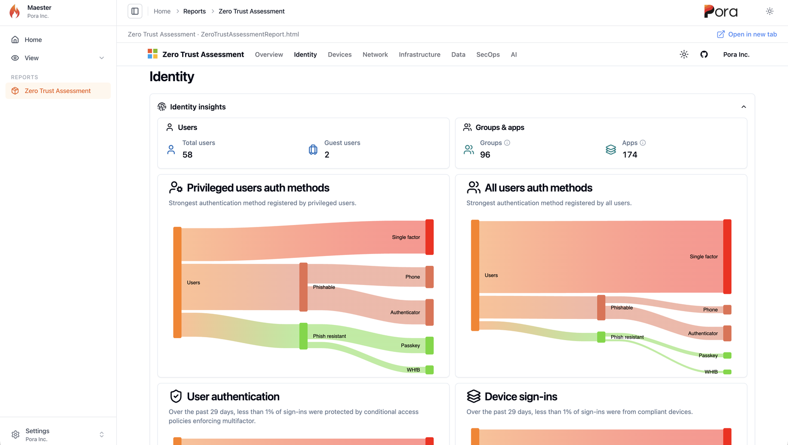

import usingPack from "./img/using-a-pack.mp4";
import usingPackPoster from "./img/using-a-pack-poster.jpg";
import buildingPack from "./img/building-a-pack.mp4";
import buildingPackPoster from "./img/building-a-pack-poster.jpg";
import installPack from "./img/install-pack.mp4";
import installPackPoster from "./img/install-pack-poster.jpg";

The Maester 3.0 preview has two new things we're really excited about: **Maester Packs**, a way to add tests that someone else wrote to Maester, and the first pack that ships with Maester, which runs **Microsoft's Zero Trust Assessment** and puts every one of its results in your Maester report.

Until now, a test came to Maester one of two ways: we shipped it in the module, or you wrote it yourself in your custom tests folder. Packs open a third way, and we think it will bring a much wider variety of tests to Maester than we could ever write on our own.

{/* truncate */}

## What is a Maester Pack?

A Maester Pack is a folder of tests, the helper functions they call and, if it needs one, a connector to a service Maester doesn't know yet. It is usually published as a GitHub repository. You install it with one command, and its tests run alongside Maester's own checks and show up in the same report.

Think of everything that sits around your Microsoft 365 tenant: a SaaS app your users sign in to, a security product with its own settings, your company's own rules for naming, licensing or break-glass accounts. The people who know those best are the vendors who build them, the consultants who audit them every week and the team that runs them. Packs let each of them write the checks once and share them with everyone who runs Maester.

That's the part we're most looking forward to: tests for products and policies we'd never have time to cover, from the people who know them best.

## Try the Maester 3.0 preview

Packs are in the Maester 3.0 preview. To try it, remove the Maester versions you have and install the newest preview:

```powershell
Uninstall-Module Maester -AllVersions
Install-Module Maester -AllowPrerelease -Scope CurrentUser
```

To go back to 2.x later, uninstall the preview and run `Install-Module Maester` without `-AllowPrerelease`. See [Upgrading from 2.x](/docs/next/upgrading-from-2x) for what changes in 3.0.

## Install a pack with one command

<video src={usingPack} poster={usingPackPoster} autoPlay loop muted playsInline controls width="100%" style={{ borderRadius: 12, marginBottom: "1.5rem" }} />

```powershell
Install-MtPack maester365/maester-pack-demo
Invoke-Maester -Pack DEMO -SkipBuiltIn
```

<video src={installPack} poster={installPackPoster} autoPlay loop muted playsInline controls width="100%" style={{ borderRadius: 12, marginBottom: "1.5rem" }} />

A pack runs code in your Maester session, so `Install-MtPack` does its homework before anything is saved:

- **It reads the pack without running any of it**: the manifest, every file and what each script calls. Anything a reviewer should look at, such as a binary file, dynamic code or a request to a host the pack didn't declare, raises its risk.
- **It waits 72 hours on new releases.** A release has to be at least three days old, so a compromised release has time to be noticed and blocked. The age comes from GitHub's immutable releases or from when your computer first saw that commit, never from a date the publisher can set.
- **It checks your pack policy and a signed blocklist.** Your organisation can say which publishers and repositories are allowed and how much risk is acceptable, and the Maester team can block a pack that turns out to be malicious.
- **It shows you what the pack reaches and asks you to approve it.** You see the tests it adds, the services and Microsoft Graph scopes it uses, and its risk. A low-risk pack takes a Yes; a high-risk pack, or a release newer than the cooldown, takes you typing the pack's code, `DEMO` in this case.

The pack's files are then stored read-only, and it is recorded in `maester-packs.lock.json` with its commit and a digest of every file. Every time Maester loads the pack, it checks the files against that lock file first. If anything changed, the pack doesn't run.

| Command | What it does |
| --- | --- |
| `Install-MtPack <owner/repo>` | Checks and installs a pack |
| `Invoke-Maester -Pack <code>` | Runs Maester's tests and that pack (add `-SkipBuiltIn` for the pack only) |
| `Invoke-Maester -AllPacks` | Runs every installed pack |
| `Get-MtPack` | Lists your packs and whether each can run |
| `Update-MtPack` | Moves to the newest release that has passed the cooldown, showing what changed |
| `Restore-MtPack` | Installs exactly what the lock file records, on another computer or in a pipeline |

### Start with the demo pack

The [Maester demo pack](https://github.com/maester365/maester-pack-demo) is the quickest way to see what a pack can do. Its eight tests are made up and change nothing, and only one reads your tenant (its name, from Microsoft Graph). Between them they show every kind of result (passed, failed, investigate, skipped and error), a pack's own connector, a Microsoft Graph read, and a long-running test that streams live progress to the dashboard.

That long-running test also adds a report of its own to the Maester report. It's a gallery of charts with made-up data: accounts by last sign-in, admin sign-ins by day and hour, device compliance by operating system, apps by permissions and users, and more. Each one comes with a note on why the chart works, as ideas for showing what a pass or fail can't. Open it under **Reports** in the left menu.



## Results in the report you already use

A pack's results land in the same Maester report as everything else, so you don't have a second report to read. Each row is marked as coming from a pack: in the results file it has `Source` `Custom` and a `Package` field with the pack's ID, version, commit and publisher, so a pack can never pass itself off as one of Maester's own checks.



## In a pipeline

Commit `maester-config.json` and `maester-packs.lock.json` with your tests. Your pipeline then restores exactly the files you approved, without asking anyone anything:

```powershell
Restore-MtPack
Invoke-Maester -AllPacks -NonInteractive
```

## Share packs privately, inside your company or team

Packs don't have to be public. A lot of the most useful checks are the ones that only make sense for one organisation: your naming rules, the apps only you use, the exceptions your auditors agreed to. Packs work well for those too:

- **Private GitHub repositories.** Set `GH_TOKEN` (or `GITHUB_TOKEN`) to a token that can read the repository, and `Install-MtPack contoso/maester-internal-checks` installs from it the same way. The token is only sent to GitHub's API.
- **A local folder.** `Install-MtPack ./our-pack` installs from a folder on your computer or a share, with the same checks and the same lock file.
- **Your own rules for what may be installed.** A pack policy, in `maester-config.json` or as a machine-wide file, can allow only your own GitHub organisation with `AllowedPublishers` or only named repositories with `TrustedSources`, and cap the risk you accept.

So a security team can keep one pack of company checks, and every consultant, admin and pipeline that runs Maester gets the same tests at the same pinned version.

## Browse packs on the Maester Packs site

[packs.maester.cloud](https://packs.maester.cloud) is where you find packs. It lists the public packs their publishers have published there, and you can search them by name, publisher or service.



Each pack has its own page with everything you'd want to know before you install it: the command to install it, its risk, price and licence, the tests it adds, the connector it brings, what the security scan found, and its entry for `maester-packs.lock.json`. A pack is listed only after the site has read it and run the same checks and security scan that `Install-MtPack` runs.



### For publishers

Publishers sign in with GitHub. Pick one of the public repositories you administer, press **Check** to see whether its latest release is ready, and **Publish** to list it. Publishing registers the pack's Guid and code to you, so nobody else can publish a pack under them, even if your repository later goes private.

Once you're signed in, **Your packs** shows each pack you've published with its active installations, tenants and runs over the last 30 days. You see totals only, never who ran a pack.



Packs you keep private, in a private repository or a local folder, never appear on the site and don't need to be published there.

## Write your own pack

The quickest way to start is the [Maester demo pack](https://github.com/maester365/maester-pack-demo). It is a template repository with one test for each kind of result, a test setting, a family of results, its own connector, a Microsoft Graph read and a long-running test with live progress. Press **Use this template**, run its setup function with your pack's ID and code, and replace the made-up tests with your own:

```powershell
. ./tools/Initialize-MtPackFromDemo.ps1
Initialize-MtPackFromDemo -Id contoso.google-workspace -Code CNT -Name 'Contoso Google Workspace checks'
Test-MtPack .            # every check Install-MtPack runs, without installing
Invoke-MtTest -Path .    # run the pack's tests from its folder
```

Push it, create a GitHub release, and anyone can install it with `Install-MtPack <owner>/<repository>`. Publish it on [packs.maester.cloud](https://packs.maester.cloud) so people can find it. If you'd rather start from an empty pack, `New-MtPack` creates one. The tests are the same native tests that Maester's own checks use, so everything in [Writing tests](/docs/next/writing-tests) applies.

### For pack builders

[Writing a pack](/docs/next/packs/writing-a-pack) is the guide for pack builders, with the detail this post skips: the manifest and its code, tests and helpers, connectors, live output and progress, the banner image, checking a pack with `Test-MtPack` in its own CI, and publishing a release. [Pack security](/docs/next/packs/security) covers what `Install-MtPack` checks and what raises a pack's risk.

<video src={buildingPack} poster={buildingPackPoster} autoPlay loop muted playsInline controls width="100%" style={{ borderRadius: 12, marginBottom: "1.5rem" }} />

### Tools in any language

The pack itself is PowerShell today, but the work doesn't have to be. A pack's test can run a tool written in Python, Go, Node.js or anything else in its own process, and that tool can show its live progress in the Maester dashboard just by writing lines like this to its output:

```text
##maester[progress] {"stage":"Running tests","completed":12,"total":40}
```

This is how the Zero Trust Assessment pack works (more below). Next, we're working on packs written entirely in other languages: the manifest already reserves a `Runtime` for them, and this preview refuses those packs with a clear message until a Maester version that runs them ships.

## The Zero Trust Assessment pack

The first pack that ships with Maester runs Microsoft's [Zero Trust Assessment](https://aka.ms/zerotrust/assessment). You don't install it: it is part of the module and only runs when you ask for it.

### Run the Zero Trust Assessment

1. Install the assessment's module once:

   ```powershell
   Install-Module ZeroTrustAssessment -Scope CurrentUser
   ```

2. Connect Maester to your tenant. You don't run `Connect-ZtAssessment` yourself: Maester uses this connection to know which tenant to assess.

   ```powershell
   Connect-Maester
   ```

3. Name the pack when you run Maester:

   ```powershell
   Invoke-Maester -Pack ZTA -SkipBuiltIn    # only the Zero Trust Assessment
   Invoke-Maester -Pack ZTA                 # Maester's tests and the assessment
   ```

   After an interactive `Connect-Maester`, a browser opens once more so you can sign in for the assessment.

The assessment loads its own versions of the Microsoft Graph, Exchange Online and Az modules, so Maester runs it in a separate PowerShell process and signs in there for you. While it runs, the full-screen dashboard follows it live: the six stages of the assessment, the exports and tests running and finished, the results by Zero Trust pillar, and any errors as they happen. On a large tenant it can take an hour or more, so in a pipeline you can also run the assessment as its own step and point Maester at the report it wrote.

Every assessment result becomes a row in the Maester report, `ZTA.<test ID>`, with the assessment's title, risk as the severity, and its pillar as a tag. Your Zero Trust results sit next to your CIS, CISA, EIDSCA and Maester checks, and filter and export the same way.



Maester also embeds the assessment's own HTML report, with its pillar dashboards and charts, in the Maester report. Open it with the **Zero Trust Assessment** button on the overview, under **Reports** in the left menu, or from any ZTA result. It works offline, so the Maester report is still a single file you can share.





The [Zero Trust Assessment pack guide](/docs/next/packs/zero-trust-assessment) covers running it in GitHub Actions and other pipelines, the settings, and how the assessment's statuses map to Maester's.

## Try it and tell us what you think

Packs and the Zero Trust Assessment pack are in the Maester 3.0 preview. [Install the preview](#try-the-maester-30-preview), try the demo pack, and if you're thinking about writing a pack for your product or your team, we'd love to hear about it on [GitHub](https://github.com/maester365/maester/discussions) or [Discord](https://discord.maester.dev).

- [Maester Packs](/docs/next/packs)
- [Writing a pack](/docs/next/packs/writing-a-pack)
- [Pack security](/docs/next/packs/security)
- [Zero Trust Assessment pack](/docs/next/packs/zero-trust-assessment)
- [Maester Packs site](https://packs.maester.cloud)
- [Maester demo pack](https://github.com/maester365/maester-pack-demo)

<small>The screenshots use made-up data: the Maester Packs site's own sample packs and a made-up Contoso publisher, the Contoso sample tenant from the report's own test data, the demo pack's made-up results and insights, and a test tenant for the Zero Trust Assessment.</small>
