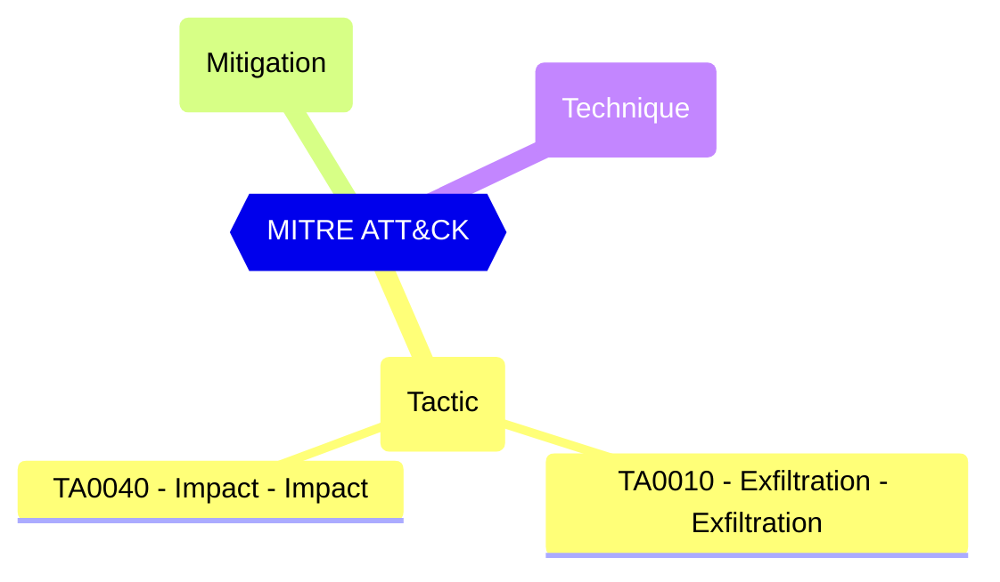

<!-- This file is generated by website/scripts/generate-test-docs.mjs. Do not edit manually. -->

# EIDSCA.AP12 - Default Authorization Settings - Default User Role Permissions - Allowed to create Tenants.

<div className="test-byline"><div className="test-byline-avatars"><a className="test-byline-avatar test-byline-avatar--author" href="/contributors/cloud-architekt" title="Thomas Naunheim · Original author"></a></div><div className="test-byline-meta"><span className="test-byline-text">Contributed by <a href="/contributors/cloud-architekt">Thomas Naunheim</a></span><a className="test-byline-link" href="/contributors">All contributors →</a></div></div>

## Overview

Restricts the creation of Entra ID (Azure AD) tenants to the global administrator or tenant creator roles. Anyone who creates a tenant will become the global administrator for that tenant.

Restrict tenant creation by non-admin users. Users assigned the Tenant Creator role can still create tenants when this setting is false.

#### Test script
```
https://graph.microsoft.com/beta/policies/authorizationPolicy
.defaultUserRolePermissions.allowedToCreateTenants -eq 'false'
```

#### Remediation action

Microsoft Graph PowerShell: ```Update-MgPolicyAuthorizationPolicy -BodyParameter @{DefaultUserRolePermissions = @{AllowedToCreateTenants = $false}}```

#### Related links

- [Open in Graph Explorer](https://developer.microsoft.com/graph/graph-explorer?request=policies/authorizationPolicy&method=GET&version=beta&GraphUrl=https://graph.microsoft.com)
- [authorizationPolicy resource type - Microsoft Graph beta | Microsoft Learn](https://learn.microsoft.com/graph/api/resources/authorizationpolicy?view=graph-rest-beta)
- [View in Microsoft Entra admin center](https://entra.microsoft.com/#view/Microsoft_AAD_UsersAndTenants/UserManagementMenuBlade/~/UserSettings)

## MITRE ATT&CK


|Tactic|Technique|Mitigation|
|---|---|---|
|[TA0010 - Exfiltration - Exfiltration](https://attack.mitre.org/tactics/TA0010)<br/>[TA0040 - Impact - Impact](https://attack.mitre.org/tactics/TA0040)|||

## Test Metadata

| Field | Value |
| --- | --- |
| Test ID | EIDSCA.AP12 |
| Severity | Medium |
| Suite | Entra ID SCA |
| Product | Entra ID |
| Feature | User and directory settings |
| Area | Access control |
| Resource type | Tenant |
| User impact | Low |
| Implementation cost | Low |
| MITRE ATT&CK | None |
| Supports controls | nist-800-53-r5:AC-6, nist-800-53-r5:CM-7 |
| PowerShell test | [Test-MtCheckEidscaAP12](https://github.com/maester365/maester/blob/main/tests/eidsca/Test.EIDSCA.AP12.ps1) |
| Services | Graph |

## Source

- Test: [`tests/eidsca/Test.EIDSCA.AP12.ps1`](https://github.com/maester365/maester/blob/main/tests/eidsca/Test.EIDSCA.AP12.ps1)
- Documentation: [`tests/eidsca/Test.EIDSCA.AP12.md`](https://github.com/maester365/maester/blob/main/tests/eidsca/Test.EIDSCA.AP12.md)
